<p align="center">
  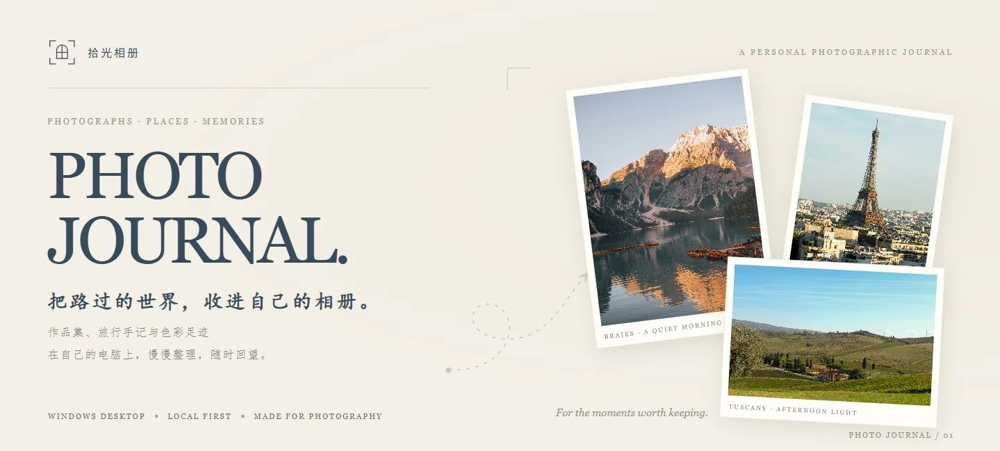
</p>

<h1 align="center">拾光相册 · Photo Journal</h1>

<p align="center">
  <strong>一本留在自己电脑里的摄影与旅行画册。</strong><br>
  整理照片，记录足迹，回看色彩，把喜欢的瞬间做成作品。
</p>

<p align="center">
  
  
  
</p>

<p align="center">
  <a href="#界面预览">界面预览</a> ·
  <a href="#特色功能">特色功能</a> ·
  <a href="#开始使用">开始使用</a> ·
  <a href="docs/USER_GUIDE.md">完整使用指南</a> ·
  <a href="https://github.com/Idiotyevsky/Photo-Journal/issues">反馈问题</a>
</p>

## 界面预览

暖白纸感、克制的留白、欧式街角插画。照片保留完整构图，像翻开一本慢慢编好的旅行画册。

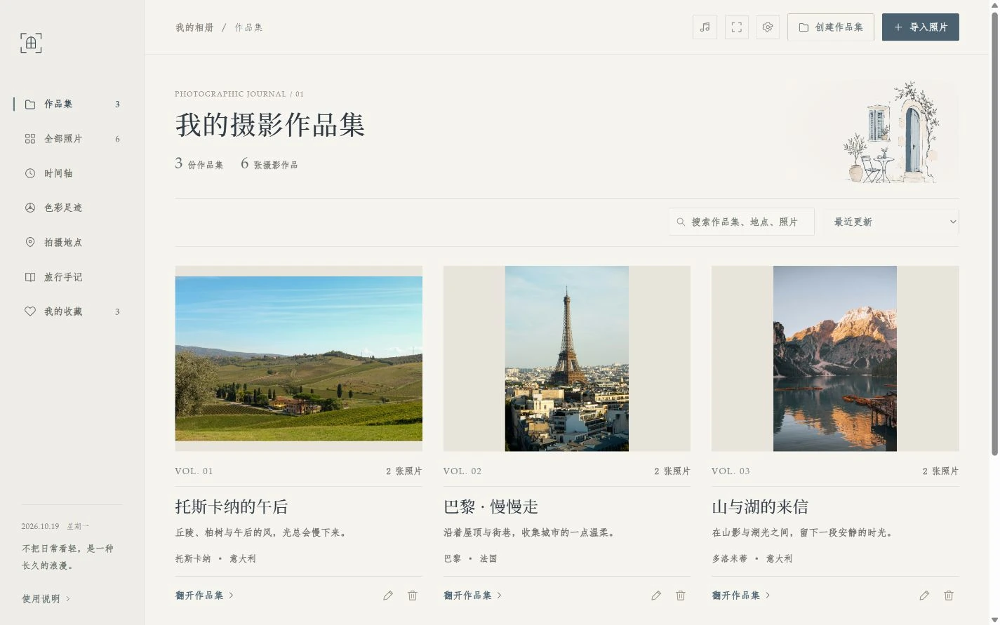

<sub>截图来自应用的实际界面，使用独立演示资料；照片作者、来源及演示信息说明见 [配图说明](docs/SOURCES.md)。</sub>

## 特色功能

| 整理自己的作品 | 记录走过的地方 | 留下可以分享的回忆 |
| :--- | :--- | :--- |
| **自由编排作品集**：创建封面、填写简介，拖动照片安排阅读顺序。 | **彩色手绘足迹**：中国看城市、世界看国家，手动编辑沿途路线。 | **经典白边照片**：相机标识与拍摄参数，紧凑排版，导出 JPG。 |
| **时间轴与旅行手记**：按时间回看，把文字留在照片旁。 | **色彩足迹**：按月、季度或年份，观察镜头里的冷暖、明暗与主色。 | **4K 作品集视频**：清晰圆角画面、柔和背景、淡入淡出与自选配乐。 |
| **批量导入与收藏**：拖入照片、选择文件夹、自动去重，爱心收藏喜欢的作品。 | **两种画册主题**：经典与意大利油画，选择适合当下心情的界面。 | **完整迁移包**：程序、照片、音乐和整理资料打包成 ZIP，换电脑继续。 |

### 沿着地图，回看旅途

在世界地图上串起去过的国家，在中国地图上连接到访的城市。路线可以手动排序、填写日期和笔记，也能关联拍摄地点中的照片。

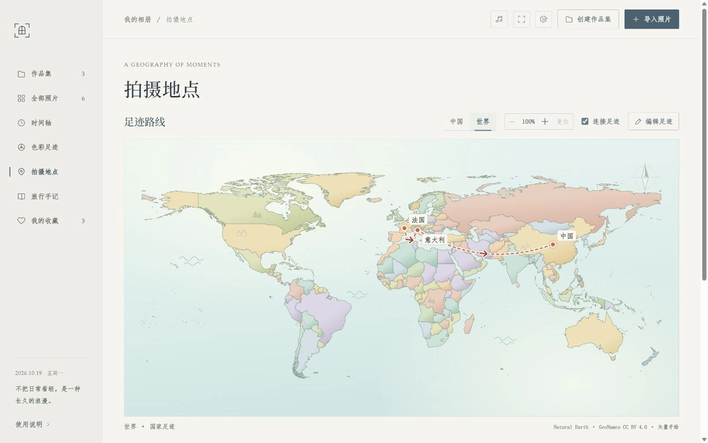

- **矢量绘制**：放大后仍保持清晰，路线、箭头和标记随视角调整。
- **自由查看**：支持 1–4 倍缩放、拖动，以及 Ctrl + 鼠标滚轮缩放。
- **离线定位**：结合照片 GPS 与本地地名目录，没有 GPS 也可以手动落点。

<details>
<summary>展开查看中国地图与城市路线</summary>

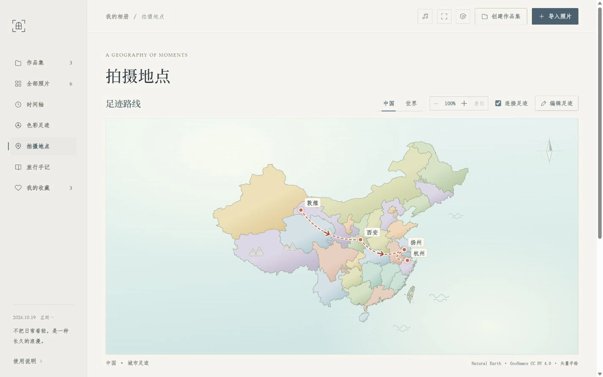

</details>

### 看见不同时光里的色彩

春日的浅色、城市的灰蓝、夏末的浓绿，都可以成为一张色卡。按月份、季度或年份查看主色比例，也可以把两段时光并排比较。

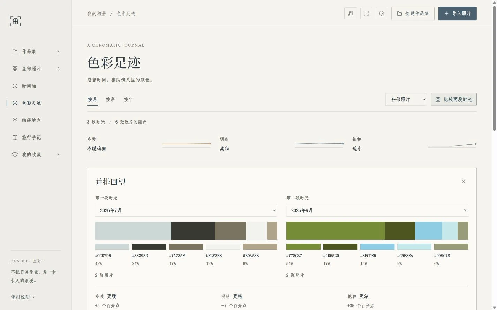

点击色块，回到贡献这些颜色的照片；切到「我的收藏」，单独看看自己偏爱的画面。分析在本机完成，照片本身不被改写。

### 把照片做成作品，把作品集做成影片

<table>
  <tr>
    <td width="50%" valign="top">
      <h4>白边作品 · JPG</h4>
      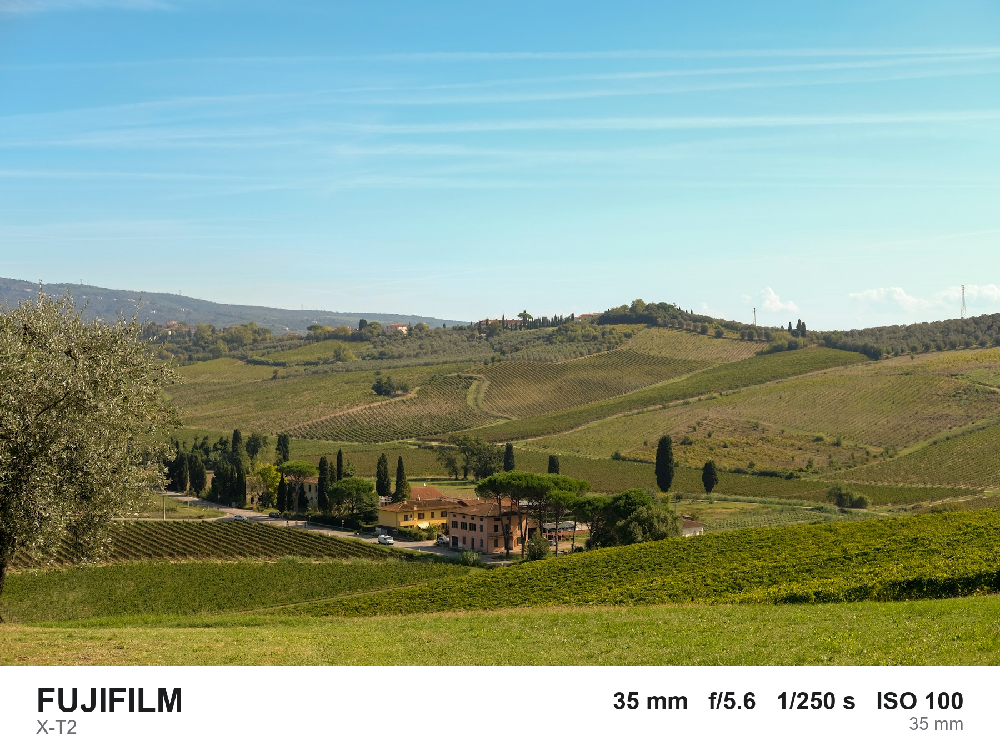
      <p>经典白条、相机标识与拍摄参数。信息缺失时自动省略，导出新的图片，保留原图。</p>
    </td>
    <td width="50%" valign="top">
      <h4>作品集影片 · MP4</h4>
      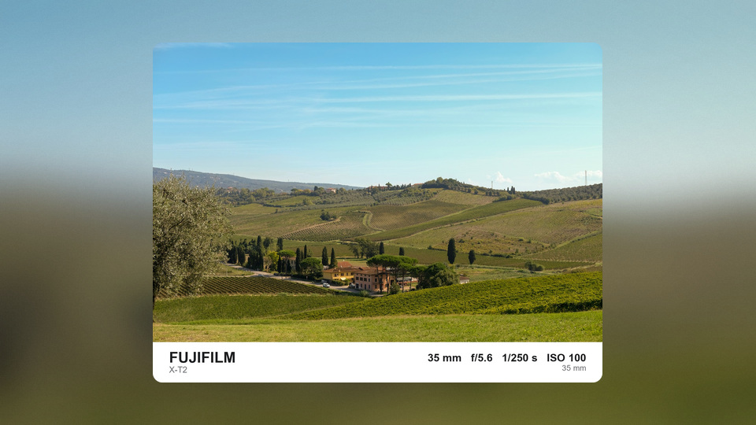
      <p>白边照片居中放映，圆角保持清晰，背景柔和铺开；配合淡入淡出和自己的音乐。</p>
    </td>
  </tr>
</table>

视频默认 **4K · 3840 × 2160**，也支持 1440p、1080p 与 720p。可按作品集编排播放，调整单张停留时长，从导入曲库中选择背景音乐，或保留安静的无配乐版本。

<details>
<summary>展开查看视频导出窗口</summary>

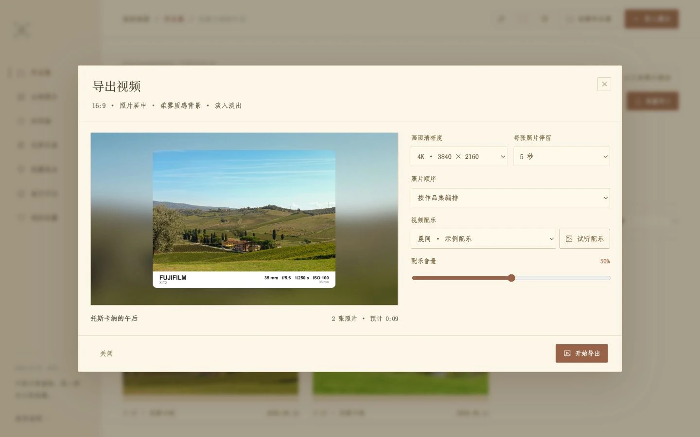

单次最多 300 张照片、30 分钟。可以查看进度或取消，完成后保存为独立 MP4 文件。

</details>

### 三种主题，换一种翻阅心情

**经典**用暖白与蓝灰铺开画册；**意大利油画**以暖象牙、陶土、橄榄绿铺陈托斯卡纳乡间气息，油画小景、藤蔓边饰、陶砖花样与柏树陶罐贯穿各个页面；**希腊**以爱琴海蓝白、陶砖回纹、海浪和橄榄枝点缀导航、作品卡片、时间轴、旅行手记、地图边框及设置窗口。主题只改变界面，照片的颜色和导出效果保持原样。

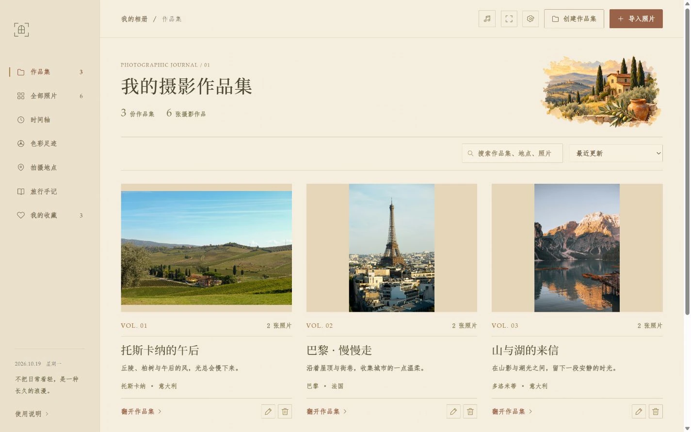

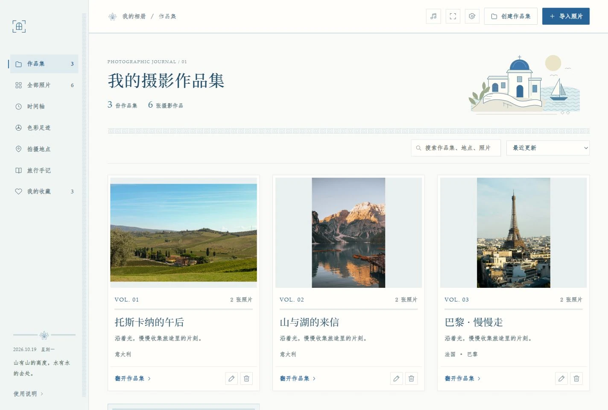

### 一句开场白，一点背景音乐

打开相册，先用一句短句停留片刻，再自动进入主界面。每天随机一句，同一天保持一致，一轮展示完再重新洗牌；可以管理内置的 100 句开场白，也可以写下自己的句子。

相册默认安静，点击音符即可随机播放或静音。内置 9 首舒缓纯音乐，也支持导入自己的曲子、试听、调整音量，以及通过 GD 音乐台在线选曲。

<details>
<summary>展开查看开场白、句库与音乐管理</summary>

<table>
  <tr>
    <td width="50%">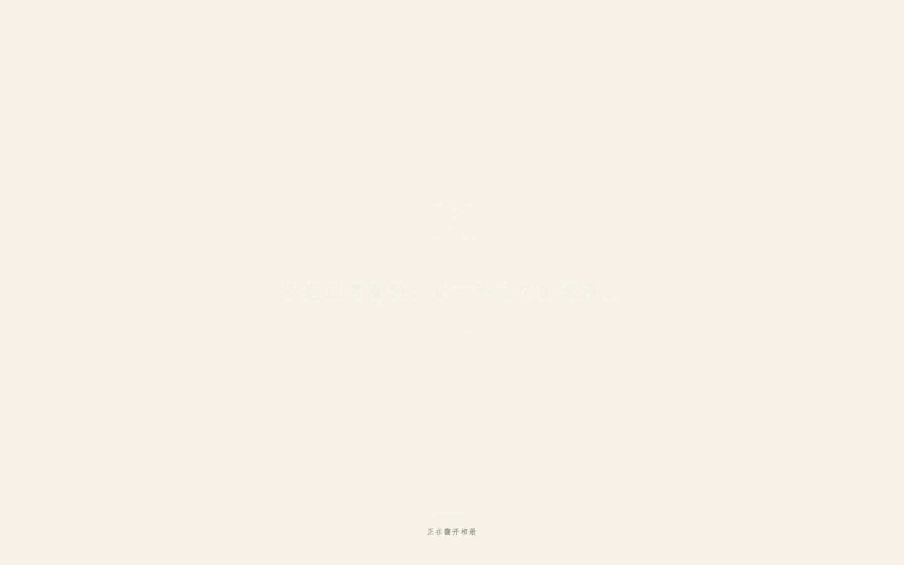<p align="center">每天，用一句话翻开相册。</p></td>
    <td width="50%">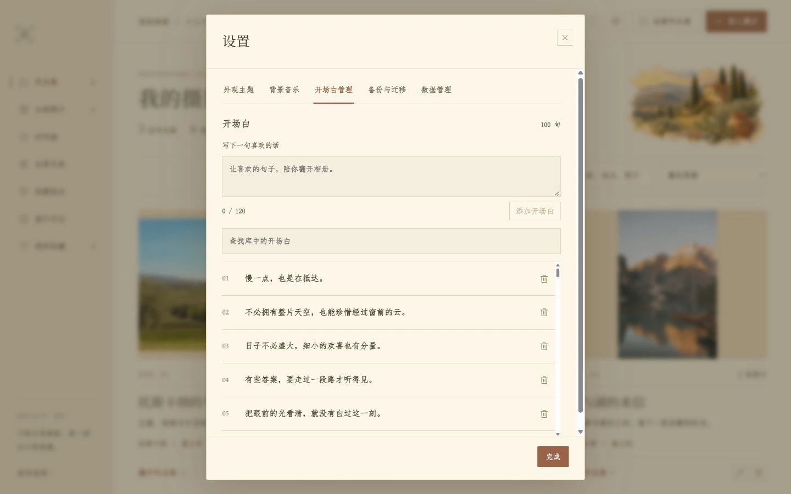<p align="center">把喜欢的句子也收进来。</p></td>
  </tr>
  <tr>
    <td colspan="2">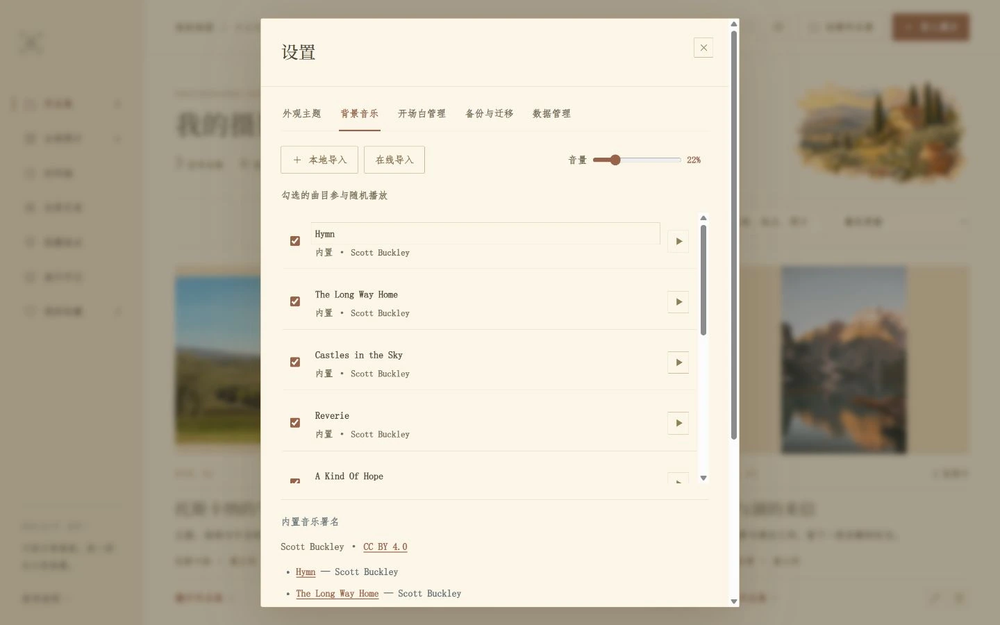</td>
  </tr>
</table>

照片整理、地图、色彩分析与导出均可离线使用；在线音乐搜索和试听需要联网，成功导入后可离线播放。

</details>

## 开始使用

**系统环境：64 位 Windows 10 / 11，已安装 Microsoft Edge WebView2 运行时。**

已有打包程序时，把 `拾光相册.exe` 放在可写文件夹中，双击打开即可。APP 默认最大化，**F11** 切换全屏，**Esc** 先关闭当前弹窗，再退出全屏。打包程序不需要另外安装 Python。

当前仓库提供源码，尚未发布 GitHub Release 安装包。可以使用 **Python 3.12** 在本机运行：

```powershell
git clone https://github.com/Idiotyevsky/Photo-Journal.git
cd Photo-Journal
py -3.12 -m venv .venv
.\.venv\Scripts\python.exe -m pip install -r requirements-desktop.txt
.\.venv\Scripts\python.exe desktop.py
```

生成独立桌面程序：

```powershell
.\.venv\Scripts\python.exe build_desktop.py
```

输出的 `拾光相册.exe` 位于项目根目录。这个项目是 Windows 桌面 APP，内嵌界面与本地服务会随窗口启动和关闭。

### 从第一张照片开始

1. **创建作品集**，写下名字、地点和一段简介。
2. **批量选择、拖入照片或导入文件夹**，自动读取已有 EXIF、去重并生成预览。
3. **编排照片、点亮收藏、补充手记与足迹**，按自己的方式整理。
4. **导出白边作品、制作视频，或保存完整迁移包**。

照片支持 JPG、PNG、WebP、GIF、BMP、TIFF；音频支持 MP3、WAV、M4A、AAC、OGG、FLAC。照片与音频均为单文件不超过 100 MB；HEIC、RAW 照片请先转换。

## 资料留在本地，也能一起带走

无需账号，照片和整理资料保存在程序旁的 `album-data` 文件夹中。导入会保存副本，不移动或改写最初的源文件。

```text
拾光相册.exe
album-data/
├── originals/       照片原图副本
├── previews/        浏览预览
├── music/           导入的音乐
└── album.sqlite3    作品集、手记、足迹、收藏、设置与开场白进度
```

进入 **设置 → 备份与迁移 → 导出完整迁移包**，程序、照片、导入音乐与全部整理资料会一起放进 ZIP。在另一台电脑完整解压，再打开其中的 EXE，即可继续。

**完整迁移请用 ZIP。**「导出文字资料」生成的 JSON 不含照片与音频，不能替代完整备份。另存的作品和视频是独立文件，请自行一同保留。

## 文档与开发

| 入口 | 内容 |
| :--- | :--- |
| [完整使用指南](docs/USER_GUIDE.md) | 导入、作品集编排、地图、音乐、导出、迁移及数据管理 |
| [开发与验证](docs/USER_GUIDE.md#开发与重新打包) | 环境准备、打包方式与测试命令 |
| [截图与照片来源](docs/SOURCES.md) | 演示资料说明、照片作者与授权来源 |
| [反馈问题](https://github.com/Idiotyevsky/Photo-Journal/issues) | 提交复现步骤、使用体验或功能建议 |

**主要组成**：Python 3.12 · pywebview / WebView2 · HTML / CSS / JavaScript · SQLite · Pillow · FFmpeg。

感谢 Natural Earth、GeoNames、Scott Buckley 及相关开源组件。素材和组件说明：[地图](ui/maps/vector-CREDITS.md) · [音乐](ui/audio/CREDITS.md) · [视频](assets/third-party/VIDEO-COMPONENTS.md) · [在线音乐](assets/third-party/ONLINE-MUSIC.md)。

---

<p align="center"><sub>为那些值得再看一次的瞬间。</sub></p>
